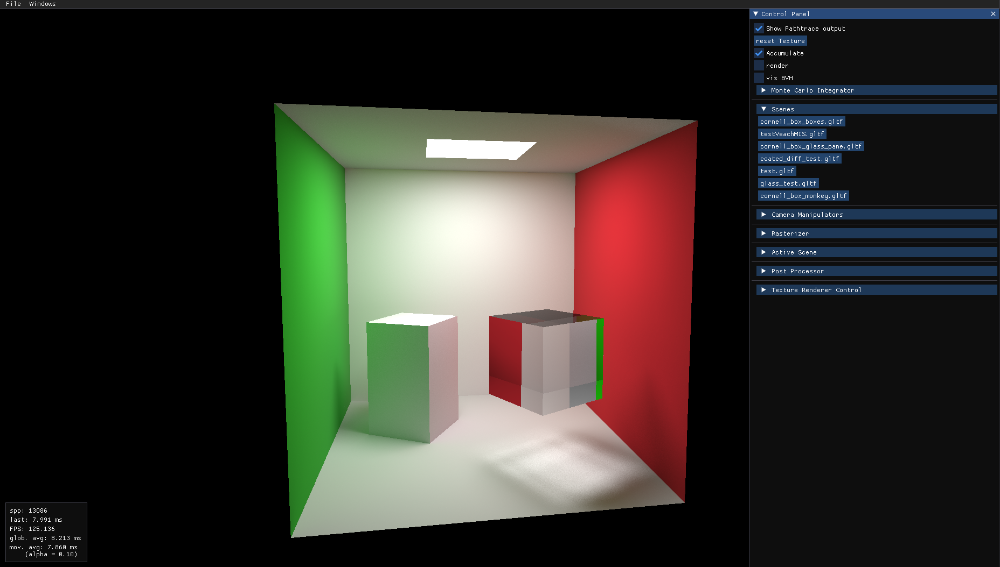

# Custom built path tracer

This project is my from scratch path tracer to learn more about path tracing in practice



### Build Steps

##### Quick List of steps I had to take to get this to build on a fresh linux install (Excluding installing cmake and a c++ toolchain)

 - Clone submodules ```git submodule update --init --recursive```
 - Install some missing libs (trial-and-error from cmake errors)
 - Install mesa libraries ```sudo apt-get install libglu1-mesa libglu1-mesa-dev```
 - Reload Cmake Project (CLion only)
 - Set Working directory of cmake run configuration to project root